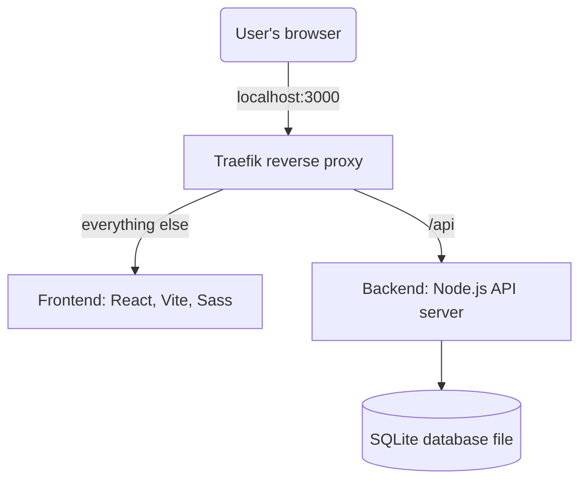

# Getting Started Todo App

This project provides a sample todo list application. It demonstrates all of
the current Docker best practices, ranging from the Compose file, to the
Dockerfile, to CI (using GitHub Actions), and running tests. It's intended to 
be well-documented to ensure anyone can come in and easily learn.

## Application architecture



This sample application is a simple React frontend that receives data from a
Node.js backend. The backend stores its data in a single SQLite file, using
the SQLite module built into Node.js, so there is no database server to run.

When the application is packaged and shipped, the frontend is compiled into
static HTML, CSS, and JS and then bundled with the backend where it is then
served as static assets. So no... there is no server-side rendering going on
with this sample app.

During development, since the backend and frontend need different dev tools, 
they are split into two separate services. This allows [Vite](https://vitejs.dev/) 
to manage the React app while [nodemon](https://nodemon.io/) works with the 
backend. A [Traefik](https://traefik.io/) reverse proxy sends every request to
`/api` to the backend and everything else to Vite, so the browser sees a single
origin, just like in production. With containers, it's easy to separate the
development needs!

## Development

To spin up the project, simply install Docker Desktop and then run the following 
commands:

```
git clone https://github.com/docker/getting-started-todo-app
cd getting-started-todo-app
docker compose up --watch
```

The container images get downloaded and built and, after a moment, the
application will be up and running! No need to install or configure anything on your machine!

Simply open [http://localhost:3000](http://localhost:3000) to see the app up and running!

Any changes made to either the backend or frontend should be seen immediately
without needing to rebuild or restart the containers.

### Tearing it down

When you're done, simply remove the containers by running the following command:

```
docker compose down
```

Your todo items are kept in the `todo-sqlite-data` volume, so they'll still be
there the next time you start the app. To start over with an empty list, add
`--volumes` to the command above.
